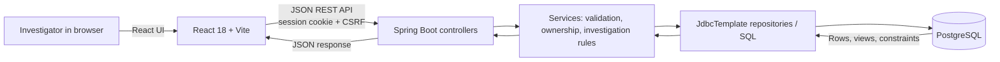

<div align="center">

# CASETRACE

### Every clue has a connection. Every record tells a story.

**A relational mystery investigation platform for connecting evidence, examining recorded accounts, reconstructing timelines, and reviewing contradictions.**

<p>
  
  
  
  
  
  
</p>

**[Overview](#overview) · [Features](#features) · [Architecture](#architecture) · [Database](#database-design) · [Run locally](#run-locally) · [API](#api-overview) · [Security](#security)**

</div>

---

## Overview

CASETRACE is a college DBMS project built around fictional investigations. An investigator follows a case across people, evidence, CCTV observations, access events, phone records, witness statements, vehicles, and timeline entries. The application uses PostgreSQL relationships and queries to return connected records and potential alibi/location conflicts; it does not treat a mismatch as proof of guilt.

The database is the source of investigation records. React presents those records, and the Spring Boot API validates requests, applies ownership rules, searches across record types, and evaluates a theory after submission.

## Features

| Area | What is implemented |
|---|---|
| Case archive and files | Browse cases, open a dossier, and create investigator-owned cases. Owners can update, change status, archive, or delete their own files. |
| Investigator accounts | Register, sign in/out, view and update a profile, change a password, and view a private dashboard. |
| Case records | Manage participants and roles, evidence, CCTV, access logs, phone records, witness statements, vehicles, vehicle movements, and authored timeline events. |
| Investigation | Search case records with supported person, location, keyword, type, evidence type, and time filters; inspect database-returned connections and contradictions. |
| Timeline | Combine time-stamped records from several relational sources into a chronological timeline. PostgreSQL also defines `investigation_timeline_v`. |
| Theory submission | Submit a suspected person, method, location, time, explanation, and supporting evidence. The API evaluates and persists the submission; solution details are not included in ordinary case responses. |
| Investigator activity | Dashboard case activity and evidence review state are stored for the authenticated investigator. |
| Interface | Responsive dark investigation workspace, case briefing, search filters, timeline, profile badge, and a custom SVG favicon. |


## Technology stack

| Layer | Project configuration |
|---|---|
| Frontend | React 18.3.1, Vite 5.4, Tailwind CSS 3.4, JavaScript (ES modules) |
| UI utilities | `lucide-react` 0.468.0 for icons; `jsbarcode` 3.12.3 for the investigator badge barcode |
| Backend | Java 21 target, Spring Boot 4.1.1, Spring Web MVC, JDBC, Validation, Security |
| Database | PostgreSQL JDBC driver and PostgreSQL 16+ (project setup target) |
| Build and tools | Maven, npm (lockfile available), PostgreSQL `psql`; Postman can be used to inspect REST calls |

Versions above come from `frontend/package.json` and `backend/pom.xml`. PostgreSQL is installed and managed separately; database scripts are under `database/`.

## Architecture



The frontend API client is centralized in `frontend/src/lib/api.js`. Spring controllers delegate to services and JDBC repositories; SQL is explicit for case and investigation queries. PostgreSQL stores case records and provides constraints, indexes, and views. The solve service reads the private solution key only while evaluating a submitted theory.

## Database design

The core model uses case-scoped participation: a person is stored once in `person`, while `case_person` associates that person with a case and their role in it. Composite foreign keys keep evidence links and participant references within the same case. `location` is shared among incidents and recorded events.

```mermaid
erDiagram
    LOCATION ||--o{ CASE_FILE : "incident location"
    LOCATION ||--o{ EVIDENCE : "found at"
    LOCATION ||--o{ CAMERA : "camera location"
    LOCATION ||--o{ ACCESS_EVENT : "access at"
    LOCATION ||--o{ VEHICLE_EVENT : "movement at"
    LOCATION ||--o{ CASE_EVENT : "event at"
    LOCATION ||--o{ ALIBI_CLAIM : "claimed at"
    LOCATION ||--o{ CASE_SOLUTION : "solution location"
    LOCATION o|--o{ SOLUTION_SUBMISSION : "submitted location"

    INVESTIGATOR o|--o{ CASE_FILE : "creates"
    INVESTIGATOR ||--o{ INVESTIGATOR_CASE_ACTIVITY : "visits"
    CASE_FILE ||--o{ INVESTIGATOR_CASE_ACTIVITY : "activity for"
    INVESTIGATOR ||--o{ INVESTIGATOR_EVIDENCE_REVIEW : "reviews"
    CASE_FILE ||--o{ INVESTIGATOR_EVIDENCE_REVIEW : "reviewed in"
    EVIDENCE ||--o{ INVESTIGATOR_EVIDENCE_REVIEW : "reviewed record"

    CASE_FILE ||--o{ CASE_PERSON : includes
    PERSON ||--o{ CASE_PERSON : participates
    CASE_FILE ||--o{ EVIDENCE : records
    EVIDENCE ||--o{ EVIDENCE_PERSON : links
    CASE_PERSON ||--o{ EVIDENCE_PERSON : links
    CASE_FILE ||--o{ CAMERA : has
    CAMERA ||--o{ CCTV_OBSERVATION : records
    CASE_PERSON o|--o{ CCTV_OBSERVATION : appears
    CASE_PERSON ||--o{ ACCESS_EVENT : uses
    CASE_PERSON ||--o{ PHONE_RECORD : calls
    CASE_PERSON ||--o{ WITNESS_STATEMENT : "witness / subject"
    CASE_PERSON ||--o{ VEHICLE : owns
    VEHICLE ||--o{ VEHICLE_EVENT : moves
    CASE_FILE ||--o{ CASE_EVENT : records
    CASE_PERSON ||--o{ ALIBI_CLAIM : makes
    WITNESS_STATEMENT o|--o{ ALIBI_CLAIM : supports

    CASE_FILE ||--o| CASE_SOLUTION : has
    CASE_SOLUTION ||--o{ SOLUTION_EVIDENCE : cites
    EVIDENCE ||--o{ SOLUTION_EVIDENCE : supports
    CASE_FILE ||--o{ SOLUTION_SUBMISSION : receives
    INVESTIGATOR o|--o{ SOLUTION_SUBMISSION : submits
    SOLUTION_SUBMISSION ||--o{ SUBMISSION_EVIDENCE : cites
    EVIDENCE ||--o{ SUBMISSION_EVIDENCE : supports

    LOCATION {
      bigint location_id PK
      text name
      text address
      text location_type
    }
    CASE_FILE {
      bigint case_id PK
      string case_code UK
      text title
      timestamptz incident_at
      bigint location_id FK
      string status
      string case_type
      bigint created_by_investigator_id FK
    }
    PERSON {
      bigint person_id PK
      text full_name
      smallint age
      text occupation
    }
    CASE_PERSON {
      bigint case_id PK, FK
      bigint person_id PK, FK
      string case_role
    }
    EVIDENCE {
      bigint evidence_id PK
      bigint case_id FK
      string evidence_code
      text evidence_type
      string relevance
    }
    EVIDENCE_PERSON {
      bigint evidence_id PK, FK
      bigint person_id PK, FK
      string connection_type PK
    }
    CAMERA {
      bigint camera_id PK
      bigint case_id FK
      string camera_code
      bigint location_id FK
    }
    CCTV_OBSERVATION {
      bigint observation_id PK
      bigint case_id FK
      bigint camera_id FK
      bigint person_id FK
      timestamptz observed_at
    }
    ACCESS_EVENT {
      bigint access_event_id PK
      bigint case_id FK
      bigint person_id FK
      bigint location_id FK
      timestamptz occurred_at
    }
    PHONE_RECORD {
      bigint call_id PK
      bigint case_id FK
      bigint caller_id FK
      bigint receiver_id FK
      timestamptz occurred_at
    }
    WITNESS_STATEMENT {
      bigint statement_id PK
      bigint case_id FK
      bigint witness_id FK
      bigint subject_id FK
      timestamptz recorded_at
    }
    VEHICLE {
      bigint vehicle_id PK
      bigint case_id FK
      bigint owner_id FK
      string registration_number UK
    }
    VEHICLE_EVENT {
      bigint vehicle_event_id PK
      bigint case_id FK
      bigint vehicle_id FK
      bigint location_id FK
      timestamptz occurred_at
    }
    CASE_EVENT {
      bigint event_id PK
      bigint case_id FK
      bigint location_id FK
      timestamptz occurred_at
    }
    ALIBI_CLAIM {
      bigint claim_id PK
      bigint case_id FK
      bigint person_id FK
      bigint claimed_location_id FK
      timestamptz claim_start
      timestamptz claim_end
      bigint source_statement_id FK
    }
    CASE_SOLUTION {
      bigint case_id PK, FK
      bigint culprit_id FK
      bigint location_id FK
    }
    SOLUTION_EVIDENCE {
      bigint case_id PK, FK
      bigint evidence_id PK, FK
    }
    SOLUTION_SUBMISSION {
      bigint submission_id PK
      bigint case_id FK
      bigint investigator_id FK
      boolean is_correct
    }
    SUBMISSION_EVIDENCE {
      bigint submission_id PK, FK
      bigint evidence_id PK, FK
    }
    INVESTIGATOR {
      bigint investigator_id PK
      string username UK
      string email UK
      string password_hash
    }
    INVESTIGATOR_CASE_ACTIVITY {
      bigint investigator_id PK, FK
      bigint case_id PK, FK
      timestamptz last_activity_at
    }
    INVESTIGATOR_EVIDENCE_REVIEW {
      bigint investigator_id PK, FK
      bigint case_id PK, FK
      bigint evidence_id PK, FK
      timestamptz reviewed_at
    }
```



The ER diagram shows the main relational tables. Other schema details include `case_type`, status and value checks, unique constraints, indexed case/time lookups, and the `investigation_timeline_v` and `contradiction_v` views. A database trigger marks a case `CLOSED` when a correct submission is inserted. There are no extra assignment/team/room tables in the current SQL schema.

### SQL files and initialization order

For a **new, empty `casetrace` database**, run:

1. `database/001_schema.sql` — core tables, keys, constraints, indexes, views, and trigger.
2. `database/002_seed.sql` — three fictional starter cases and their records.
3. `database/004_authentication.sql` — investigator accounts and per-investigator activity tables.
4. `database/005_case_creation.sql` — case type and creator ownership fields.
5. `database/006_case_management_status.sql` — permits the `UNDER REVIEW` case status.

`database/003_investigation_queries.sql` contains examples for manual use; it is **not** an initialization or migration script. Do not rerun `001_schema.sql` or `002_seed.sql` on a database that already contains CASETRACE data. Apply later numbered migrations once, in order, to an existing database.

## Repository layout

```text
CASETRACE/
├── database/                 # PostgreSQL schema, seed, query examples, migrations
├── docs/architecture.md      # Detailed architecture and original DBMS design notes
├── backend/
│   ├── src/main/java/...     # Controllers, services, JDBC repositories, DTOs, security
│   ├── src/main/resources/   # Spring Boot configuration
│   ├── src/test/java/...     # Service-level automated tests
│   ├── .env.example          # Safe local DB configuration template
│   └── pom.xml               # Maven / Java / Spring Boot dependencies
└── frontend/
    ├── src/auth/             # Login, registration, dashboard, investigator profile
    ├── src/components/       # Shared header, branding, navigation components
    ├── src/lib/api.js        # Central REST API client
    ├── public/               # Static assets including favicon.svg
    ├── .env.example          # Frontend API URL template
    └── package.json          # Vite scripts and frontend dependencies
```

Generated folders (`node_modules`, `.pnpm-store`, `target`, and `dist`) are excluded.

## Prerequisites

- **JDK 21** (the Maven project compiles for Java 21).
- **Maven 3.6.3+**. No Maven Wrapper is included.
- **Node.js 18+ and npm** for the Vite 5 frontend. `frontend/package-lock.json` supports reproducible npm installs.
- **PostgreSQL 16+** and `psql` command-line tools.

Use the official installers for [Java](https://adoptium.net/), [Maven](https://maven.apache.org/install.html), [Node.js](https://nodejs.org/), and [PostgreSQL for Windows](https://www.postgresql.org/download/windows/). Confirm the commands are on PATH in a new PowerShell window:

```powershell
java -version
mvn -version
node --version
npm --version
psql --version
```

## Run locally

The steps below use PowerShell and assume the database server is running locally. They create a new development database; if `casetrace` already contains data, skip database creation and apply only migrations that are not yet installed.

### 1. Clone the repository

```powershell
git clone https://github.com/dhruv-asati/CASETRACE.git
cd CASETRACE
```

### 2. Create and initialize PostgreSQL

Create an empty database. `psql` will prompt for the PostgreSQL administrator password; do not put a real password into these commands or commit it.

```powershell
psql -h localhost -p 5432 -U postgres -d postgres
```

At the `psql` prompt:

```sql
CREATE DATABASE casetrace;
\q
```

Apply the SQL files from the backend directory. `ON_ERROR_STOP` stops on the first SQL error, and `psql` prompts for the database password as needed:

```powershell
cd backend
psql -h localhost -p 5432 -U postgres -d casetrace -v ON_ERROR_STOP=1 -f ..\database\001_schema.sql
psql -h localhost -p 5432 -U postgres -d casetrace -v ON_ERROR_STOP=1 -f ..\database\002_seed.sql
psql -h localhost -p 5432 -U postgres -d casetrace -v ON_ERROR_STOP=1 -f ..\database\004_authentication.sql
psql -h localhost -p 5432 -U postgres -d casetrace -v ON_ERROR_STOP=1 -f ..\database\005_case_creation.sql
psql -h localhost -p 5432 -U postgres -d casetrace -v ON_ERROR_STOP=1 -f ..\database\006_case_management_status.sql
```

The starter data defines **The Missing Diamond**, **The Locked Room Mystery**, and **The Vanishing Prototype**. Optional investigation queries use a `:case_id` placeholder; replace it with an integer in `database/003_investigation_queries.sql` before running the file in `psql`.

### 3. Configure and start the backend

`backend/src/main/resources/application.properties` reads a local `.env` file from the backend working directory. Copy the ignored local template and enter the database credentials you configured:

```powershell
Copy-Item .env.example .env
notepad .env
```

The template contains:

```dotenv
DB_HOST=localhost
DB_PORT=5432
DB_NAME=casetrace
DB_USERNAME=postgres
DB_PASSWORD=your_postgres_password
```

Replace the placeholder in your local `backend/.env`. The file is ignored by Git. Spring also accepts these values as environment variables. Optional settings include `SERVER_PORT` (default `8080`), `FRONTEND_ORIGIN` (default `http://localhost:5173`), and `SESSION_COOKIE_SECURE` (default `false`; enable behind HTTPS).

Run from `backend/`:

```powershell
mvn spring-boot:run
```

The API listens at `http://localhost:8080` by default. It does not automatically initialize the schema; the SQL scripts above must be applied first.

### 4. Configure and start the frontend

In a second PowerShell window, from the repository root:

```powershell
cd frontend
Copy-Item .env.example .env.local
npm ci
npm run dev
```

Open `http://localhost:5173`. The default frontend API URL is `http://localhost:8083`, matching the local CASETRACE configuration. If your backend runs on the default Spring Boot port `8080`, set `VITE_API_BASE_URL=http://localhost:8080` in `frontend/.env.local` before starting Vite. Restart Vite after changing the variable. The configured `FRONTEND_ORIGIN` on the backend must match the frontend origin.

### Local build and tests

Backend, from `backend/`:

```powershell
mvn test
mvn package
```

Frontend, from `frontend/`:

```powershell
npm run build
npm run preview
```

There is no frontend lint or automated test script in `frontend/package.json`. The backend includes automated service tests under `backend/src/test/java/`; these commands run the tests and package the application on the machine where invoked.

**Local verification on 2026-11-12:** `mvn test` and `mvn package` completed successfully (13 backend tests, 0 failures, 0 errors, 0 skipped), and `npm run build` completed successfully. Maven printed a Mockito dynamic Java-agent deprecation warning; it did not fail the build. These results are from this checkout and do not certify a separate database-backed deployment.

## API overview

All API routes are under `/api`. Apart from the CSRF bootstrap and registration/login endpoints, routes require an authenticated investigator session. Mutating requests require the CSRF token returned by `GET /api/auth/csrf` in the `X-XSRF-TOKEN` header. The frontend API client manages this flow and sends credentials using the browser session cookie.

| Module | Routes | Purpose |
|---|---|---|
| Authentication | `GET /api/auth/csrf`, `POST /api/auth/register`, `POST /api/auth/login`, `POST /api/auth/logout`, `GET /api/auth/me`, `PUT /api/auth/me`, `POST /api/auth/password` | CSRF bootstrap, account and session actions, investigator profile, password change |
| Dashboard | `GET /api/dashboard` | Current investigator’s profile, statistics, and recent activity |
| Cases | `GET /api/cases`, `POST /api/cases`, `GET /api/cases/{caseId}`, `PUT /api/cases/{caseId}`, `PATCH /api/cases/{caseId}/status`, `DELETE /api/cases/{caseId}` | List, create, view, update, change status, or delete a case; writes are owner-authorized |
| Case records | `GET /api/cases/{caseId}/suspects`, `/api/cases/{caseId}/evidence`, `/api/cases/{caseId}/cctv`, `/api/cases/{caseId}/access-logs`, `/api/cases/{caseId}/phone-records`, `/api/cases/{caseId}/witnesses`, `/api/cases/{caseId}/witness-statements`, `/api/cases/{caseId}/vehicles`, `/api/cases/{caseId}/vehicle-logs`, `/api/cases/{caseId}/timeline`, `/api/cases/{caseId}/connections`, `/api/cases/{caseId}/contradictions` | Read investigation records, connected relations, and potential conflicts |
| Investigation | `GET /api/cases/{caseId}/investigate` | Search/filter records using supported query parameters |
| Theory | `POST /api/cases/{caseId}/solve` | Submit and evaluate a theory; response contains feedback rather than exposing the answer key |
| Case management | `GET /api/cases/{caseId}/participants`, `GET /api/cases/{caseId}/timeline-records`; `POST` to `/api/cases/{caseId}/people`, `/api/cases/{caseId}/evidence`, `/api/cases/{caseId}/cctv`, `/api/cases/{caseId}/access-logs`, `/api/cases/{caseId}/phone-records`, `/api/cases/{caseId}/witness-statements`, `/api/cases/{caseId}/vehicles`, `/api/cases/{caseId}/vehicle-logs`, `/api/cases/{caseId}/timeline` | Read participants and authored events or add owner-managed records |
| Record management | `PUT` / `DELETE` `/api/cases/{caseId}/people/{recordId}`, `/api/cases/{caseId}/evidence/{recordId}`, `/api/cases/{caseId}/cctv/{recordId}`, `/api/cases/{caseId}/access-logs/{recordId}`, `/api/cases/{caseId}/phone-records/{recordId}`, `/api/cases/{caseId}/witness-statements/{recordId}`, `/api/cases/{caseId}/vehicles/{recordId}`, `/api/cases/{caseId}/vehicle-logs/{recordId}`, `/api/cases/{caseId}/timeline/{recordId}` | Update or remove a case child record, subject to case ownership |
| Evidence review | `GET /api/cases/{caseId}/evidence/reviews`, `POST /api/cases/{caseId}/evidence/{evidenceId}/review` | Read and record the authenticated investigator’s evidence review state |

Search supports `personId`, `locationId`, `keyword`, `eventType`, `evidenceType`, `startAt`, and `endAt`; exact validation and allowed values are enforced by the API. Read the controller methods in `backend/src/main/java/edu/casetrace/api/controller/` for request DTOs and parameter details.

## Security

- Investigator passwords are stored as BCrypt hashes (Spring Security `BCryptPasswordEncoder` configured with strength 12).
- Authentication uses a server-side HTTP session and an HttpOnly session cookie; the frontend does not store a password or session ID in local storage.
- Spring Security enables CSRF protection with a CSRF cookie and requires `X-XSRF-TOKEN` on state-changing requests.
- Credentialed CORS is restricted to the configured `FRONTEND_ORIGIN`.
- Case creation attributes its owner from the authenticated session. Case updates, status changes, deletion, and child-record mutations check case ownership in the backend.
- Password hashes and solution keys are not returned in normal API DTOs. The solution key is read only to evaluate a submitted theory.
- Never commit `backend/.env`, `frontend/.env.local`, or real database credentials.

## Future improvements

Possible next steps include adding checked-in, genuine product screenshots; extending automated frontend integration coverage; and documenting a repeatable deployment setup. These are suggestions, not claims about current functionality.

## License

No license file is currently present in the repository. All rights remain with their respective owners until a license is added.
